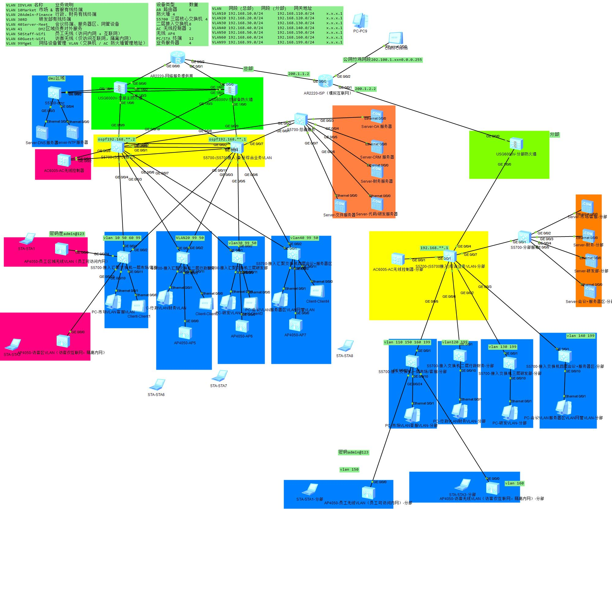

# eNSP 企业综合网络实验

> 本次实验包含总部与分部企业网络架构，涵盖二层交换、三层路由、防火墙安全、IPsec VPN 以及无线 WLAN 配置。

## 网络拓扑图

> 📥 **拓扑源文件下载**：[点击下载 ensp-topo-v8.0](ensp-topo-v8.0) 
> *（注：下载后需使用 eNSP 打开。本实验使用 eNSP 1.3.00.100 版本，包含 AR2220、S5700、USG6000V 等设备，请确保你的电脑已安装对应镜像）*
---

## 一、实验准备与拓扑搭建

1. **搭建拓扑**：打开 eNSP，新建拓扑，按逻辑拓扑图放置设备：
   - **总部**：HQ-R1、HQ-R2、HQ-FW1、HQ-FW2、HQ-CORE1、HQ-CORE2、HQ-ACC1~HQ-ACC4、HQ-ACC-DMZ、HQ-AC、AP、PC/Server。
   - **分部**：BR-R1、BR-R2、BR-FW、BR-CORE、BR-ACC1~BR-ACC4、BR-AC、AP、PC/Server；模拟 ISP 路由器。
2. **连接链路**：核心与接入用 Trunk；核心之间用 Eth-Trunk；核心与防火墙用子接口；防火墙之间用 GE1/0/2 作为 HRP 心跳。
3. **启动设备**：启动所有设备，建议先改名（`sysname`）并保存一次空配置，便于排错。

## 二、基础配置

1. **设备命名**：按规范命名设备（如 `HQ-CORE1`、`BR-FW` 等）。
2. **管理地址**：
   - 总部：VLAN99（核心 192.168.99.10/11，接入 20~23，AC 50）。
   - 分部：VLAN199（核心 192.168.199.254，接入 20~23，AC 50）。
3. **远程管理**：启用 SSH，关闭 Telnet；本地用户 admin 权限 15。
4. **时间与日志**：NTP 指向 192.168.40.16，日志发至服务器。

## 三、二层配置

1. **VLAN 创建**：
   - 总部：VLAN10、20、30、40、41、50、60、99、250、251。
   - 分部：VLAN110、120、130、140、150、160、199、252。
2. **端口配置**：接入端口设为 Access；AP 上联设为 Trunk 并放通无线与管理 VLAN。
3. **Trunk 与 Eth-Trunk**：核心与接入配 Trunk；CORE1 与 CORE2 配 Eth-Trunk1（LACP）。
4. **MSTP**：域 LNZL，实例1对应 VLAN10/30/50，实例2对应 VLAN20/40/60/99；双核心互为根桥。
5. **验证命令**：`display vlan`、`display eth-trunk 1`、`display stp brief`。

## 四、三层配置

1. **VLANIF**：双核心配置对应 VLANIF 实地址。
2. **VRRP**：HQ-CORE1 为 VLAN10/30/50 的 Master（priority 120），HQ-CORE2 为 VLAN20/40/60/99 的 Master（priority 120）。虚拟网关均为 `.1`。
3. **DHCP**：核心配置全局地址池并排除保留地址；VLAN99 使用中继指向 HQ-AC（192.168.99.50）。
4. **分部网关**：BR-CORE 配置对应 VLANIF 网关，并配置全局地址池。
5. **验证命令**：`display ip interface brief`、`display vrrp brief`、`display ip pool`。

## 五、路由配置

1. **总部 OSPF**：HQ-CORE1/2 配置 OSPF 1，router-id 1.1.1.1/1.1.1.2，宣告业务网段。VLANIF 设为 silent-interface，下发默认路由。
2. **分部 OSPF**：BR-CORE 配置 OSPF 1，router-id 3.3.3.2，宣告网段。
3. **静态路由**：核心配置默认路由指向防火墙 VRRP 虚拟 IP；防火墙配置回程路由。
4. **验证命令**：`display ospf peer brief`、`display ip routing-table`。

## 六、总部防火墙配置

1. **接口与区域**：划分 Trust（内网）、Untrust（外网）、DMZ（服务器），配置 HRP 心跳接口。
2. **HRP 双机热备**：启用 `hrp enable`，指定心跳接口，开启 standby config 和 preempt。
3. **VRRP**：防火墙上联接口配置 VRRP，FW1 为 active，FW2 为 standby。
4. **安全策略**：
   - Trust 到 Untrust / DMZ 放行。
   - Untrust 到 DMZ 仅放行 OA(80) 和 CRM(8080)。
   - 财务服务器仅 VLAN20 访问；研发服务器仅 VLAN30 访问。
   - 访客 VLAN60 仅访问 Untrust。
5. **NAT**：配置 Easy-IP；配置 nat server 将公网 80/8080 映射至 DMZ 服务器。
6. **验证命令**：`display hrp state`、`display vrrp brief`、`display security-policy`、`display nat session all`。

## 七、DMZ 配置

1. HQ-ACC-DMZ 创建 VLAN41 和 40，配置 Vlanif41 为 192.168.41.250/24。
2. 配置 NTP，启用端口安全、广播抑制和 edged-port。
3. **验证**：公网访问 DMZ 通，DMZ 访问内网不通。

## 八、总部 IPsec VPN 配置

1. **IKE 与 IPsec**：配置 IKE proposal 10（AES-256/SHA2-256/DH14），指向分部 200.1.2.2，IPsec proposal 10。
2. **ACL 3000**：定义感兴趣流（总部 VLAN10/20/30/40 到 分部 VLAN110/120/130 等）。
3. 在 GE0/0/0 接口应用 ipsec policy。
4. **验证命令**：`display ike sa`、`display ipsec sa brief`。

## 九、分部防火墙与核心配置

1. **接口与区域**：配置 Untrust、Trust、DMZ 接口及心跳口。
2. **安全策略**：Trust 到 Untrust 和 DMZ 放行；Untrust 到 Trust 仅放行 IPsec 解密流量。
3. **NAT**：配置 no_nat_ipsec 和 trust_to_untrust_nat (Easy-IP)。
4. **IPsec**：配置 ike peer HQ-FW 指向总部，ACL 3000 定义反向感兴趣流，在 GE0/0/0 应用。

## 十、分部接入层 ACL 配置

1. **ACL 3000**：禁止访客（VLAN160）访问内网；允许财务访问财务服务器，研发访问研发服务器；最后放行。
2. 在上联 Trunk 接口 inbound 应用 ACL 3000。
3. **验证命令**：`display acl 3000`，测试权限访问。

## 十一、无线配置

1. **HQ-AC**：创建 VLAN50/60/99，配置地址池；配置 capwap source interface vlanif99。
2. 配置安全模板、SSID 模板、VAP 模板（emp-vap VLAN50，guest-vap VLAN60）；绑定至 AP 组。
3. **BR-AC**：同理配置分部无线。
4. **验证命令**：`display ap all`、`display station all`。

## 十二、测试验证

1. **连通性测试**：各部门 ping 网关、跨 VLAN 授权业务、互联网。
2. **隔离测试**：访客 ping 内网不通，ping 公网通。
3. **冗余测试**：关闭主核心上行，VRRP 切换；关闭 FW1 上行，HRP 切换；断开 Eth-Trunk 成员，业务不中断。
4. **VPN 测试**：分部访问总部 OA 通，访问财务/研发不通。
5. **记录**：保存命令输出和截图，作为验收证据。

## 十三、保存与备份

1. 所有设备执行 `save`。
2. 导出配置文件，按“设备名-日期”归档。
3. 重大变更前保存历史版本。